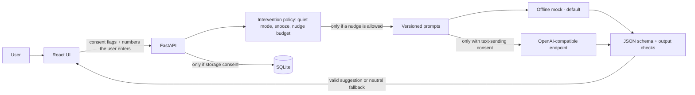

# Architecture

## Data flow

1. A session starts only when the user clicks start. It gets a random ID and expires after 14 days by default.
2. The user enters elapsed, focused and idle minutes and a context-switch count. The API checks they are numbers and that they add up. Nothing else is accepted: no keystrokes, window names, URLs or screenshots.
3. Storing these numbers in SQLite is a separate opt-in. Without it the numbers are checked and then thrown away.
4. Before any prompt is built, a rule-based policy decides if a suggestion is allowed at all (quiet mode, snooze, max nudges per hour). The model cannot change this.
5. The user's note goes into the user message as JSON, never into the system prompt.
6. The default provider is a deterministic mock, not an LLM. A real OpenAI-compatible endpoint needs HTTPS, a server-side key and the user's opt-in to sending text.
7. The answer has to be a JSON object with title, message, rationale, choices, uncertainty and evidence. It must include a dismiss or snooze option and must not contain pressure phrases or claims about the user's feelings. If it fails any check, the user sees a neutral fallback instead.

## Decisions

**No keyboard hooks or window titles.** The 2024 version logged keystrokes. That is a privacy risk and a weak measure of attention anyway, so the current version only takes numbers the user enters.

**Mock provider by default.** Tests run without a key or costs. The trade-off is that the mock says nothing about real model quality.

**No tool calling.** The model can only return text. It cannot open links, send messages or read files.

## Limits

SQLite and in-memory nudge state are fine for one local user, not for a deployed service. There is no user authentication, no encrypted database, and the app has not been tested with real users.
