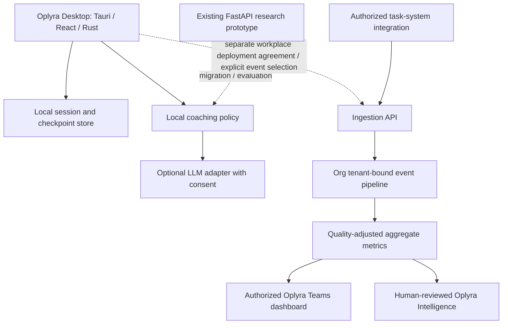

# Oplyra architecture: current and target

## Current implementation (verified by source inspection)
- `frontend/`: Vite + React/TypeScript web research prototype.
- `backend/focusbuddy/`: FastAPI, consent and validation boundaries, deterministic coaching policy, mock-by-default LLM integration, opt-in SQLite storage.
- `desktop/FocusBuddy.Sensors/`: separate C# aggregate-counter library, **not** integrated into the web UI.
- `tests/`: backend tests and existing CI.
- **Not yet implemented in this repository:** installable Oplyra desktop app, automatic monitoring, organization tenants, SSO, manager dashboards or employment scoring.

## Target architecture (proposed, not shipped)

## Architectural boundaries
1. Desktop functionality must work offline and never require an account for personal sessions.
2. No keystroke capture, screenshots, clipboard collection, webcam, hidden hooks or emotion inference.
3. No personally attributable telemetry may leave desktop by default. Any employer-managed event collection must be separately disclosed, narrowly scoped and legally reviewed.
4. Separate identity, storage and authorization for each organization; tenant isolation tests required before B2B pilots.
5. Avoid falsely presenting a mathematical activity score as job performance. Use task outcomes with transparent definitions, difficulty/context and quality measures.
6. Organizational access controlled by explicit roles, audit logs and retention schedules; no covert manager views.
7. AI explanations reference source measures, display uncertainty, and never make employment decisions.

## Compatibility migration
Keep `focusbuddy` Python imports, `FOCUSBUDDY_*` environment settings and v1 routes until a versioned deprecation and migration suite exists. Public display strings can use Oplyra immediately. Original MayDay research credit must remain intact.
